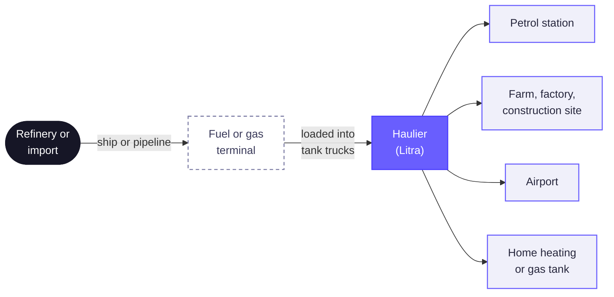
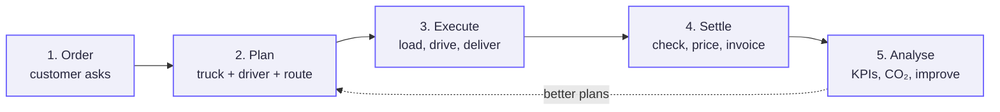

# Logistics basics - the trade in 10 minutes

> **In short:** logistics is getting the right goods to the right place, at the right time, in the right condition, at the right cost. Litra does one specific part of it: moving liquid and gas products by road, in tank trucks, from terminals to customers.

## The supply chain, and where Litra sits

**In plain words:** oil companies and gas suppliers own the product. Litra owns the trucks and the know-how to move it safely. This last stretch, from terminal to end customer, is called **secondary distribution**.

**For the tech team:** Litra's customers are mostly the product owners (fuel and gas companies), not the people at the delivery address. The system must keep "who pays" and "where we deliver" apart.

## Who is who

| Role | Who it is | In Litra's world |
|---|---|---|
| **Shipper** (consignor) | The party sending the goods | A fuel or gas company, e.g. an oil major |
| **Consignee** | The party receiving the goods | A petrol station, farm, airport, factory |
| **Haulier** (carrier) | The company that physically moves the goods | Litra |
| **Forwarder** | Organises transport but may not own trucks | Rare in tank transport |
| **3PL** | Third-party logistics: transport plus storage and other services | Litra is a specialised 3PL for liquids and gas |
| **Terminal** | Where trucks load the product | Oil and gas depots, often owned by the shipper |

## Basic transport vocabulary

- **FTL (full truckload):** one customer's goods fill the truck. **LTL (less than truckload):** several customers share one truck.
- In tank transport the "shared truck" is literal: one trailer has **several compartments**, so one trip can serve several customers or several products.
- **Primary vs secondary distribution:** primary moves product in bulk between refineries and terminals (ships, pipelines, rail). Secondary moves it from terminal to end customer, mostly by road. Litra is mainly secondary.
- **Milk run:** one truck, many stops in a row. Typical for heating oil and gas deliveries.

## The life of a transport order

Every haulier does the same five things, whatever they carry.

**In plain words:** order, plan, do, bill, learn. Litra's client slides use exactly this structure, grouped into three phases: **Planning, Execution, Back-Office**.

**For the tech team:** these five steps are the backbone of any TMS (transport management system). Each step produces data the next step needs. If that data is retyped at every step, errors creep in. That is Litra's problem today.

## Why this matters for the meeting

- Litra's whole pitch problem is "how hard can transport be?" The answer is: the line looks simple, the details are not.
- The rest of this section explains the details: [order to cash](02-order-to-cash.md), [fleet planning](03-fleet-planning.md), [tank and gas](04-tank-and-gas-transport.md), [safety rules](05-safety-and-compliance.md), [data](06-telematics-and-data.md), [pricing](07-pricing-and-billing.md) and [KPIs](08-kpis-and-esg.md).
