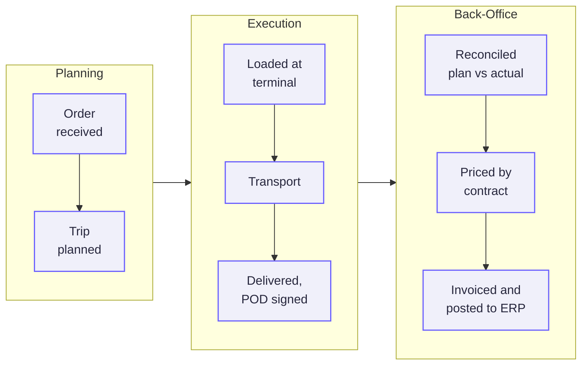
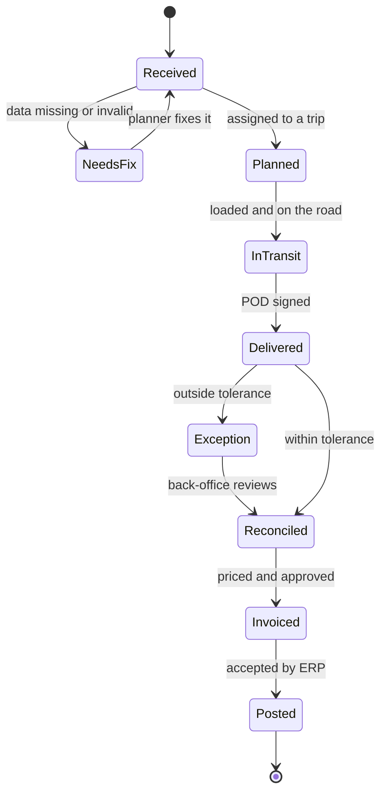

# Order to cash - from a customer request to money in the bank

> **In short:** "order to cash" is the full journey of one transport job: the customer orders, the haulier plans and delivers, then checks what really happened, prices it and sends the invoice. Every handoff in that chain is a chance to lose or corrupt data.

## The chain in eight steps

**In plain words:** three phases, eight steps. Litra's slides call them modules: Order, Planning, Loading, Transport, Unloading, Reconciliation, Pricing, Invoicing.

**For the tech team:** each phase hands a clear "output" to the next: a confirmed trip, a completed delivery with its data log, and a settled invoice with its ledger entry.

## What happens at each step

| Step | What happens | Typical data |
|---|---|---|
| **Order** | Customer sends a request by EDI, API, email or phone | Customer, delivery site, product, quantity, time window |
| **Planning** | Planner matches the order to a truck, trailer and driver and builds a route | Trip, stops, compartments, planned km and time |
| **Loading** | Driver loads at the terminal and checks the documents | Loaded quantity, temperature, loading document |
| **Transport** | Truck drives; position and events are tracked | GPS, km, driving time, waiting, incidents |
| **Unloading** | Product is delivered and the customer signs | Delivered quantity, extra work (pump, hose), signature |
| **Reconciliation** | Planned vs actual are compared | Differences in km, time, quantity, waiting |
| **Pricing** | Contract rates turn facts into money | Price lines with their source |
| **Invoicing** | Invoice is approved and sent; the ERP records it | Invoice, ledger entry, payment status |

## The documents that travel with the goods

- **Transport order** - the request. Who, what, where, when.
- **Loading document** (bill of lading, BOL) - what the terminal actually put in the truck.
- **Waybill / consignment note** (CMR, or its electronic version e-CMR) - the legal document for the journey. For dangerous goods it carries the ADR details.
- **POD (proof of delivery)** - the receiver's signature or photo that confirms the delivery. No POD, no invoice.
- **Invoice** - the bill, issued from the ERP.

## Order status: the life of one order

**In plain words:** an order moves left to right. It only stops when something is wrong: bad data at the start, or a delivery that does not match the plan at the end.

**For the tech team:** this is a state machine. Every status change is an event that other parts react to (customer update, invoice creation, ERP posting). Keep a full history per order for audit.

## The key metric: delivery-to-invoice time

How long between "POD signed" and "invoice sent"? With Excel billing this is often **days or weeks**. With an integrated flow it can be **minutes**. Faster invoicing means faster cash and fewer disputes, because the facts are still fresh.

> **Why it matters for Litra:** their vision slide asks for "instant billing on delivery, triggered by exact actual metrics". That is order to cash with no manual step in the middle.
