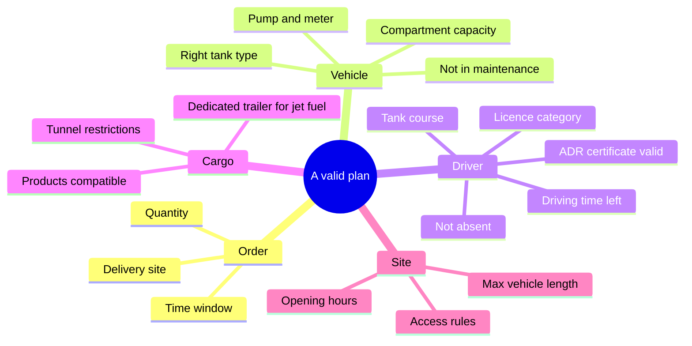
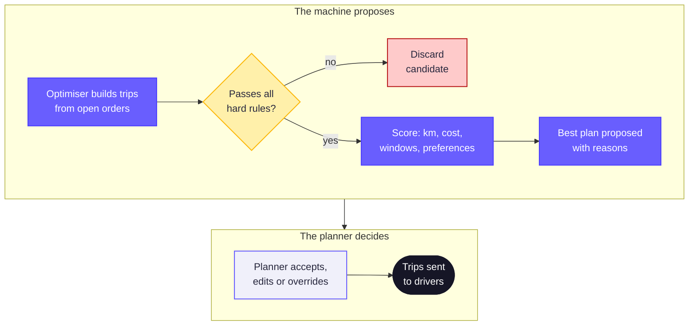

# Fleet planning - matching orders, trucks and drivers

> **In short:** planning decides which truck, which trailer and which driver take which orders, in which sequence. It is a puzzle with dozens of rules. Some rules are law and can never be broken; others are preferences a planner may bend with a good reason.

## The resources

| Resource | What it is | Why it matters |
|---|---|---|
| **Tractor unit** | The truck "head" that pulls a semi-trailer | Needs a driver with licence **CE** |
| **Semi-trailer (tank trailer)** | The tank on wheels, split into compartments | Decides capacity and which products fit |
| **Rigid tank truck** | Truck and tank body in one vehicle | Smaller, fits narrow city and farm sites; licence **C** is enough |
| **Driver** | The person, with licences and certificates | Must hold valid ADR training and enough legal driving time left |
| **Terminal** | Where the truck loads | Opening hours, loading slots, product availability |

## What makes a plan valid: the constraints

**In plain words:** before a truck leaves, a planner silently checks all of this, often from memory. A new planner needs months to learn it. That knowledge is exactly what software can hold.

**For the tech team:** each branch is a set of rules over master data (drivers, vehicles, sites, products). Master data quality decides whether the rule engine can be trusted.

## Hard rules vs soft rules

| | Hard rule (block) | Soft rule (warning) |
|---|---|---|
| **Meaning** | Law, safety or physics. Never broken | Preference or risk. A planner may override |
| **Examples** | Driver's ADR certificate expired; compartment overfilled; jet fuel mixed with other products; 10h daily driving exceeded | Arrival after the customer's time window; truck too long for a site; driver from another company; extended driving day needed |
| **What the system does** | Refuses the trip | Allows it, but asks for a comment and logs it |

## The routing puzzle in plain words

The academic name is the **vehicle routing problem** (VRP). With time windows and capacities it becomes "VRPTW" or "CVRP". In plain words: *find the cheapest set of trips that delivers every order on time, without breaking any rule.*

- With 5 orders a human finds the best plan easily.
- With 50 orders and 20 trucks the number of possible plans is astronomically large. Humans fall back to habits; optimisers search millions of options.
- Real optimisers do not promise the perfect plan. They find a **very good plan fast** and explain it.

**In plain words:** the machine proposes, the planner decides. Hard rules are filters, soft rules are scores.

**For the tech team:** two layers. A deterministic rule engine (filters and warnings) and an optimiser or ML model (scores and ranking). Keep them separate so ML can never relax a legal rule.

## Planning horizons

- **Day before:** the main plan for tomorrow. Most orders are known.
- **Same day:** urgent orders, breakdowns, delays. This is **re-planning**: changing a trip that has already started.
- **Recurring:** regular customers with fixed delivery patterns.
- **Future, VMI:** vendor-managed inventory. Sensors in the customer's tank report the level, and an order is created before the tank runs dry. The haulier plans *demand*, not just orders.

## How planners are measured

- **Utilisation** - how many hours and litres each truck works per day.
- **Empty km** - km driven without cargo, back to the terminal. Lower is better.
- **On-time delivery** - share of deliveries inside the time window.
- **Trips per planner** - how much one planner can handle.

More in [KPIs and ESG](08-kpis-and-esg.md).
