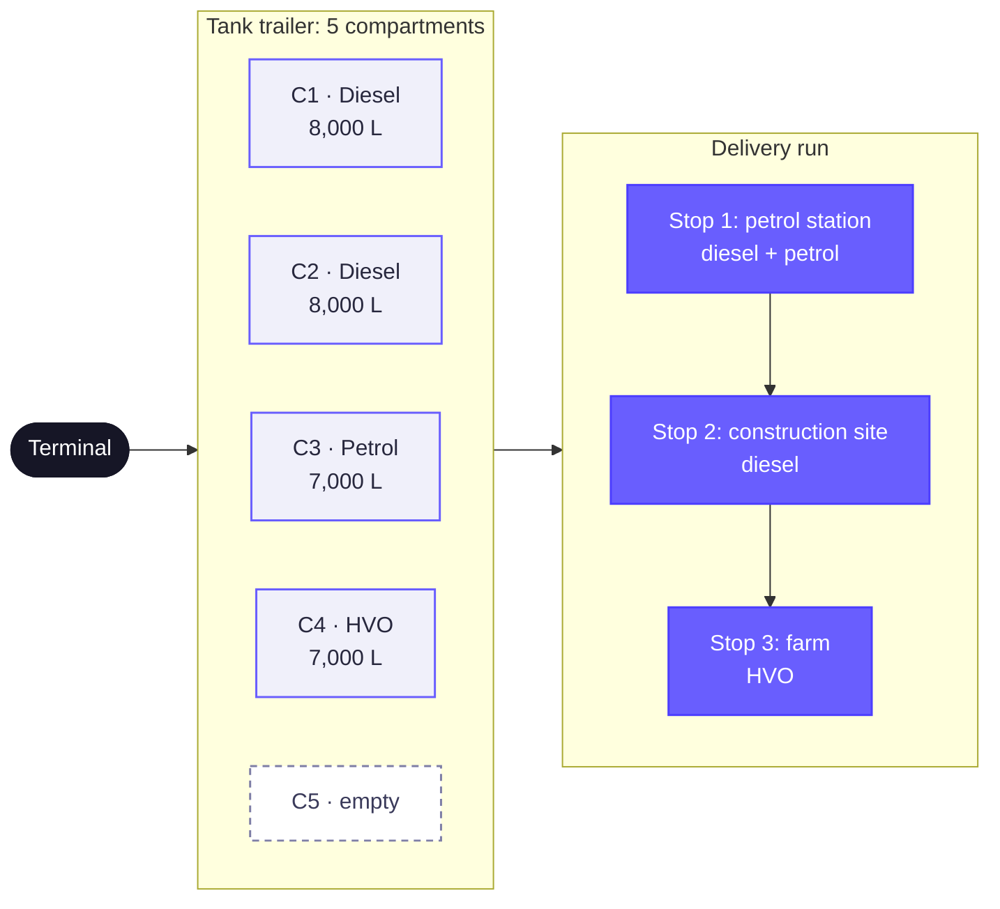
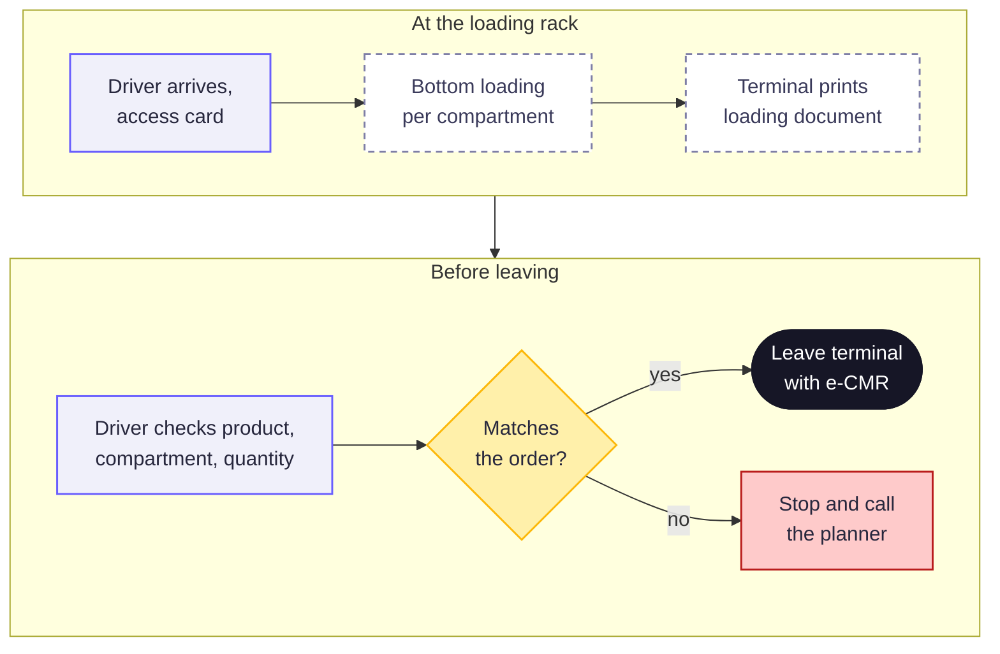

# Tank and gas transport - what makes Litra's niche special

> **In short:** carrying liquids and gases is not like carrying pallets. The cargo is dangerous, it changes volume with temperature, it can contaminate other products, and it is measured to the litre or kilo. Every one of these facts shows up later in planning and billing.

## What Litra carries

| Product | Measured in | Danger class | Special care |
|---|---|---|---|
| **Diesel, heating oil** | Litres at 15 °C | Class 3, flammable liquid | The everyday product |
| **Petrol** | Litres at 15 °C | Class 3, flammable liquid | More volatile than diesel; vapour recovery at loading |
| **Jet A-1 (aviation fuel)** | Litres at 15 °C | Class 3, flammable liquid | **Dedicated trailer**: no other product on board, strict quality control |
| **HVO / biodiesel** | Litres at 15 °C | Usually handled like diesel | Renewable fuel, growing fast in the Nordics |
| **AdBlue** | Litres | Not dangerous | Must never touch fuel; separate compartment or tank |
| **LPG (propane)** | Kilograms | Class 2, flammable gas | Pressure tank; weighed, not measured by volume |
| **LNG / liquid biogas** | Kilograms | Class 2, flammable gas | Cryogenic, around minus 160 °C, special insulated tank |
| **Chemicals** | Litres or kg | Various (often class 8, corrosive) | Product-specific tank and cleaning rules |

## One trailer, several compartments

A fuel trailer is split into **compartments** (often 4 to 7). Each compartment carries **one product**. One trip can therefore carry diesel for one customer and petrol for another.

**In plain words:** planning a tank trip means filling compartments like a puzzle: right product, right size, right delivery order, no mixing.

**For the tech team:** a "compartment allocation" step sits inside planning. Inputs: order lines, compartment sizes, product compatibility. Output: which product goes into which compartment, and what does not fit.

### Compatibility rules

- **One product per compartment.** Never mixed.
- **Jet fuel travels alone.** Aviation quality rules forbid any other product on the same trailer.
- **AdBlue stays away from fuel.** Contamination ruins the customer's engine or tank.
- **After some products, the tank must be cleaned** before carrying another (common with chemicals and food-grade liquids).

## Why "litres at 15 °C"

Liquids expand when warm and shrink when cold. Diesel grows by roughly **0.08% per °C**. The same tank holds more "warm litres" in summer than in winter, but not more product.

So the industry trades in **standard litres at 15 °C**. The meter reads the observed volume and the temperature, then converts.

| | Observed | Temperature | Standard litres at 15 °C |
|---|---|---|---|
| Diesel, hot summer day | 10,000 L | 25 °C | about **9,920 L** |
| Diesel, cold winter day | 10,000 L | minus 5 °C | about **10,170 L** |

> **Why it matters:** if loading is recorded in observed litres and delivery in standard litres, the numbers never match. Reconciliation then raises false alarms. The platform must compare like with like.

**Gases are different.** LPG and LNG are weighed in **kilograms**, often on a weighbridge at the terminal. No temperature conversion needed.

## Loading at the terminal

**In plain words:** the terminal, not Litra, measures what goes in. Its loading document (the BOL) is the trusted source for "loaded quantity".

**For the tech team:** short term, the driver photographs the loading document and confirms quantities on the tablet. Longer term, quantities come straight from the terminal's system. Which one Litra needs is an open question.

## Delivering to the customer

- **Pump or gravity:** if the customer's tank has no pump, the truck's own pump is used. That is an **extra operation** and is usually billed.
- **Meter:** a calibrated meter on the truck measures what was delivered.
- **Hose length, access, overfill protection:** site details that decide which truck can serve the site.
- **POD:** the customer signs on the tablet, or the driver takes a photo when nobody is on site (common at unmanned tanks).
- **Waiting time:** queues at the terminal or the site cost money. Customers pay for it if the contract says so, but only if it can be proven.

## Litra's gas business

Litra Gass (Norway), Litra Gas (Sweden) and Litra Finland distribute **compressed and liquefied gas**. Gas trips differ: pressure or cryogenic tanks, billing by kilograms, stricter driver qualifications and route limits through tunnels. The pre-sales analysis suggests **Litra Gass Norway** as the pilot company.
