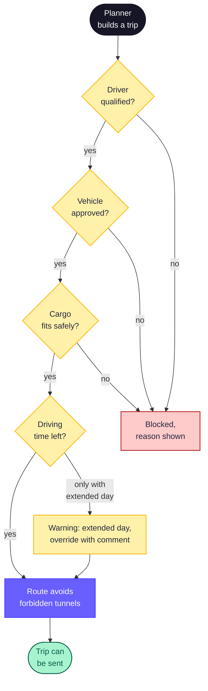

# Safety and compliance - the rules no plan may break

> **In short:** three rule books shape every trip. **ADR** says how dangerous goods travel. **EU 561** says how long a driver may drive. **CMR / e-CMR** is the legal waybill. A platform for Litra must check all three automatically, before the truck leaves.

## ADR: dangerous goods by road

ADR is the European agreement on the carriage of dangerous goods by road. Norway, Sweden, Finland and Denmark all apply it. It is updated every two years.

### The nine danger classes (the ones Litra meets are in bold)

| Class | What | Example |
|---|---|---|
| 1 | Explosives | Fireworks |
| **2** | **Gases** | **LPG, LNG, biogas** |
| **3** | **Flammable liquids** | **Diesel, petrol, jet fuel** |
| 4 | Flammable solids | Matches |
| 5 | Oxidisers, peroxides | Fertiliser |
| 6 | Toxic, infectious | Pesticides |
| 7 | Radioactive | Medical isotopes |
| **8** | **Corrosives** | **Acids, some industrial chemicals** |
| 9 | Miscellaneous | Lithium batteries |

### The UN number and the orange plate

Every dangerous product has a four-digit **UN number** (diesel is 1202, petrol 1203, LPG 1965). A tank truck shows an **orange plate** with two numbers: the hazard code on top and the UN number below.

```
 +----------+
 |    33    |   hazard code: highly flammable liquid
 +----------+
 |   1203   |   UN number: petrol
 +----------+
```

### What ADR asks for

| Of whom | Requirement |
|---|---|
| **Driver** | ADR training certificate, valid for 5 years. Tank work needs an extra **tank specialisation** course. The certificate states what it covers |
| **Vehicle** | Tank vehicles need an ADR **certificate of approval**, renewed by yearly inspection. Fire extinguishers, safety kit, orange plates |
| **Cargo** | Correct tank type for the product; compatibility; filling limits |
| **Route** | Each product has a **tunnel code**. Tunnels are graded A (no limit) to E (most limited). The route must avoid forbidden tunnels. Norway has many long road tunnels, so this is a daily constraint |
| **Documents** | The transport document lists UN number, product name, class, packing group, tunnel code and quantity. Written emergency instructions are on board |

## EU 561: driving and rest time

Norway applies the EU rules through the EEA agreement. A digital **tachograph** in every truck records driving, breaks and rest. Inspectors can read it at the roadside.

| Rule | Limit |
|---|---|
| Daily driving | **9 hours**, extendable to **10 hours twice a week** |
| Break | **45 minutes** after **4.5 hours** of driving (can be split 15 + 30) |
| Weekly driving | **56 hours** max |
| Two-week driving | **90 hours** max |
| Daily rest | **11 hours** (may be cut to 9 hours, three times between weekly rests) |
| Weekly rest | **45 hours** (may be cut to 24 hours under conditions) |

> **Why it matters:** a plan that looks fine on a map can be illegal because the driver has only 3 hours of driving left today. The platform needs the driver's remaining time, ideally from the tachograph data.

## The waybill: CMR and e-CMR

- **CMR** is the international road transport convention and its consignment note: who sends, who carries, who receives, what, how much.
- **e-CMR** is the electronic version with the same legal value. Norway and Denmark have joined the e-CMR protocol; check the current status for Sweden and Finland.
- **eFTI** is a newer EU rule: from **9 July 2027**, authorities in the EU must accept freight information in electronic form from certified platforms. Norway follows through the EEA agreement.
- For dangerous goods, the waybill also carries the **ADR particulars** (UN number, class, packing group, tunnel code).

## The pre-trip safety check

Before every trip the driver walks around the vehicle: tyres, lights, leaks, valves, earthing cable, ADR equipment, fire extinguishers. Done on paper today in many companies; on a tablet it becomes a record with a timestamp.

## All checks together, before a trip is accepted



| Check | What it covers |
|---|---|
| Driver qualified? | ADR certificate valid **on the trip date**, tank course, licence category, not absent |
| Vehicle approved? | ADR approval valid, not in maintenance, right truck and trailer combination |
| Cargo fits safely? | Products allowed in this tank, compatible with each other, fit the compartments |
| Driving time left? | Remaining legal driving time from the tachograph |

**In plain words:** most checks are a hard yes or no. Driving time has a grey zone: the law allows an extended day twice a week, so the planner may decide, but must say why.

**For the tech team:** the checks need valid-from and valid-to dates on certificates and approvals, and they are evaluated **for the trip date**, not for today. Every override is written to the audit log.
