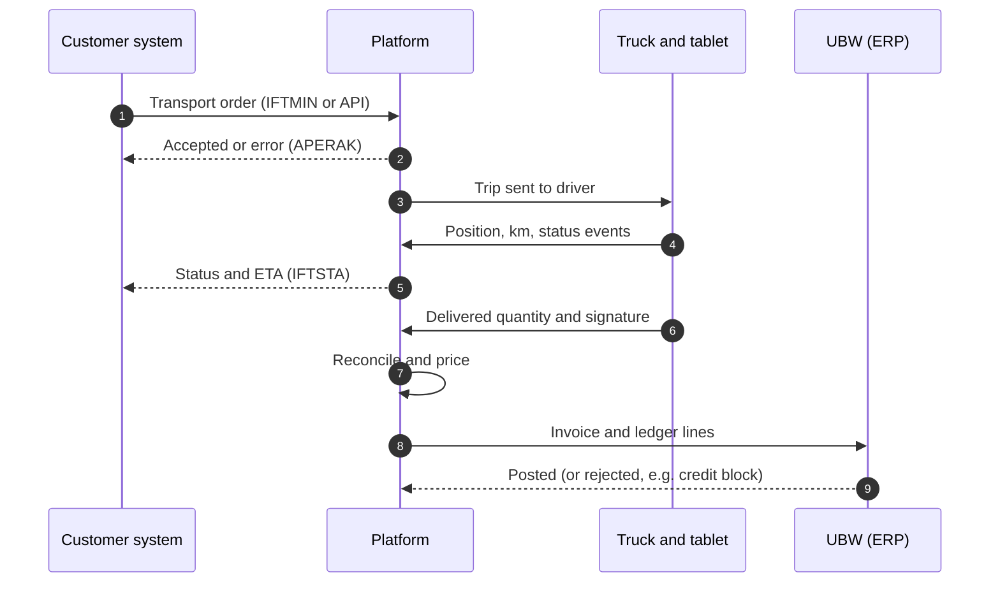

# Telematics and data exchange - how facts travel without retyping

> **In short:** trucks report their own position, distance and driving time (telematics). Customers send orders from their own systems (EDI and APIs). The ERP records the money. Connecting these three automatically is what removes manual handoffs.

## Telematics: the truck as a data source

Every modern truck has a box that reads data from the vehicle and sends it over the mobile network.

| Data | Where it comes from | Used for |
|---|---|---|
| **GPS position** | Telematics box or the driver's tablet | Live map, ETA, arrival detection |
| **Odometer (km)** | Vehicle CAN bus (the truck's internal network) | Billing by km, reconciliation |
| **Driving and rest time** | Digital tachograph | Legal planning limits |
| **Fuel use, idling** | CAN bus | Cost, CO₂, driver coaching |
| **Events** | Engine on/off, harsh braking, door or valve sensors | Safety, proof of what happened |

### rFMS: one standard for many truck brands

Litra's fleet mixes brands (for example Scania and Volvo). Each brand has its own portal. **rFMS** (remote Fleet Management System) is a standard interface that the big European truck makers support. One integration can read position, km, fuel and driver state from all of them.

> **Reality check:** some fleets use third-party telematics boxes instead. Which providers Litra uses, per company, is an open question for 1 Dec.

### Geofences and dwell time

A **geofence** is a virtual circle around a terminal or customer site. When the truck enters and leaves it, the system knows the **arrival time**, the **departure time** and therefore the **dwell time** on site. That is how waiting time can be proven to a customer without trusting anyone's memory.

## EDI and APIs: talking to customers' systems

| Channel | What it is | Typical use |
|---|---|---|
| **EDI (EDIFACT)** | Old but very common message standard between companies | Large fuel companies sending orders |
| **REST API** | Modern web interface | Newer customers, portals, internal systems |
| **Webhooks** | The platform pushes a message when something changes | Status updates to customers |
| **Email, phone** | Humans | Smaller customers; must be typed in or parsed |

### The EDIFACT messages to know

| Message | Direction | Meaning |
|---|---|---|
| **IFTMIN** | Customer to Litra | "Here is a transport order" |
| **APERAK** | Litra to customer | "Your message was accepted" or "it has an error" |
| **IFTSTA** | Litra to customer | "Status update: loaded, delivered, delayed" |
| **INVOIC** | Litra to customer | Electronic invoice (often via the ERP) |

## How the data flows end to end

**In plain words:** the order is typed once, by the customer's own system. Everything after that is filled in by machines: the truck, the tablet and the platform.

**For the tech team:** every arrow is an integration with its own format, retry rules and error handling. A message log with "resend" is essential, because integrations fail in real life.

## The ERP: UBW (Unit4)

- **UBW** is Unit4 Business World (formerly Agresso), an ERP widely used in the Nordics. Litra keeps it as the **system of record** for invoices and the general ledger.
- The new platform does **not** replace UBW. It sends finished invoice data to it.
- UBW can say no: for example, a customer is **credit-blocked** by finance. The platform must show that error and let someone retry once it is fixed.
- In Norway, B2B invoices are often sent as **EHF**, the national electronic invoice format based on the European PEPPOL standard. UBW can handle the sending.

## Master data: the boring foundation

Customers, delivery sites, terminals, products, trucks, trailers and drivers. If the same site has three different codes in three systems, nothing above can work. A common source of master data is a precondition for "zero re-keying".
