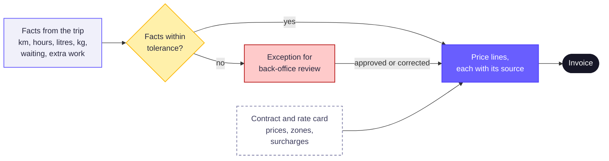

# Pricing and billing - turning a trip into an invoice

> **In short:** each customer has a contract that says how a trip is priced: by volume and distance zone, by weight, or by km and hours, plus extras like waiting time and pump use. Billing is correct only if the facts it uses are correct, so a check of planned vs actual (reconciliation) comes first.

## The three building blocks

**In plain words:** facts plus contract equals price. A person only looks at the trips where the facts look odd.

**For the tech team:** every invoice line keeps a reference to where its number came from (telematics, POD, driver, contract). That traceability is what makes customers and auditors trust automatic billing.

## Common tariff models in tank transport

| Model | How it works | Typical for |
|---|---|---|
| **Volume by zone** | Price per m³ (1,000 standard litres), depending on the distance zone from the terminal | Fuel distribution to stations and farms |
| **Weight by zone** | Price per tonne, by distance zone | Gas (LPG, LNG), bulk |
| **Km + hour** | Price per driven km plus price per hour of trip time | Irregular or long jobs, dedicated trucks |
| **Fixed per trip** | One price per run | Regular routes |

### Common extras (surcharges)

- **Additional drop:** a fee for each extra stop beyond the first.
- **Waiting time:** billed per started block of minutes beyond a free allowance, if the contract allows it.
- **Extra operations:** use of the truck's pump, long hose, after-hours delivery.
- **Fuel surcharge:** price adjusted when diesel prices move, often by an index.
- **ADR or special handling surcharge:** for demanding products.

> **The biggest estimation risk:** nobody outside Litra yet knows how many tariff types they have, or how messy they are. "Price per m³ by zone" is easy. Hundreds of customer-specific exceptions kept in Excel are not.

## A worked example

Customer contract: volume by zone. Delivery 12 km from the terminal falls in zone 0-25 km.

| Line | Quantity | Rate | Amount | Source |
|---|---|---|---|---|
| Diesel transport, zone 0-25 km | 18.4 m³ | 95 NOK/m³ | 1,748 NOK | Proof of delivery |
| Additional drop | 1 | 450 NOK | 450 NOK | Plan and POD |
| Waiting time beyond 30 free minutes | 22 min | 15 NOK/min | 330 NOK | Telematics geofence |
| Pump use | 1 | 350 NOK | 350 NOK | Driver, confirmed by site data |
| **Total excl. VAT** | | | **2,878 NOK** | |

*Illustrative prices only.*

## Reconciliation: planned vs actual

Before pricing, the platform compares what was planned with what happened. Default tolerances used in the demo:

| Check | Tolerance | Compared against |
|---|---|---|
| Distance | ±5% | Planned km vs truck odometer |
| Trip time | ±10%, after removing confirmed waiting | Planned vs actual duration |
| Quantity | ±0.5% | Loaded (terminal) vs delivered (meter, POD) |
| Waiting time | ±10 minutes | Driver report vs telematics geofence |
| Proof of delivery | Must exist for every stop | Tablet signature or photo |

Within tolerance: **auto-approved**. Outside: an **exception** that a back-office person reviews, with all the evidence on one screen.

## After pricing: approve, post, correct

- **Approval:** some contracts allow auto-approval, others need a person to approve each invoice.
- **Invoice rhythm:** per trip, or collected into one monthly invoice per customer.
- **Posting:** the invoice goes to UBW, which records it in the ledger and sends it to the customer.
- **Credit note:** if a posted invoice was wrong, it is never edited. A credit note cancels it fully or partly, and a new invoice is issued if needed.
- **Multi-company, multi-country:** NOK, SEK, DKK and EUR, each with its own VAT rules and invoice language.
