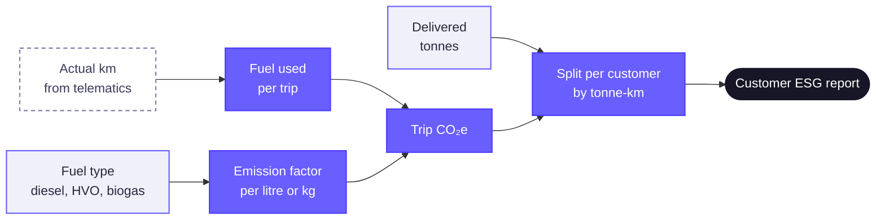

# KPIs and ESG - how success is measured

> **In short:** transport managers watch a handful of numbers: are we on time, are trucks busy, how much do we drive empty, how fast do we invoice. Customers increasingly also ask: how much CO₂ did my deliveries emit? Litra's evaluation criteria name both ROI and ESG.

## Operational KPIs

| KPI | Question it answers | Good direction |
|---|---|---|
| **On-time delivery** | Share of deliveries inside the agreed time window | Up |
| **Truck utilisation** | Hours or litres per truck per day | Up |
| **Empty km share** | Km driven without cargo, out of all km | Down |
| **Compartment fill rate** | How full the tank is when it leaves the terminal | Up |
| **Orders needing manual fix** | Orders that arrived with missing or wrong data | Down |
| **Planner productivity** | Trips planned per planner per day | Up |

## Back-office KPIs (where the ROI lives)

| KPI | Question it answers | Today (Excel) vs target |
|---|---|---|
| **Auto-reconciled share** | Trips that needed no human check | Low today, target most trips |
| **Auto-priced share** | Trips priced without manual calculation | Near zero today |
| **Manual corrections** | Invoice lines changed by hand | High today |
| **Delivery-to-invoice time** | Hours from POD to invoice sent | Days today, minutes as target |
| **Credit notes** | Invoices that had to be corrected | Down |

> **Why these matter:** Litra wants the investment "fully recouped through operational savings". These back-office KPIs are the easiest savings to prove: fewer hours of re-keying, fewer billing errors, faster cash.

## ESG and CO₂ per trip

ESG means Environmental, Social and Governance reporting. For a haulier the "E" is mostly **greenhouse gas emissions from transport**.

- **ISO 14083** (2023) is the international standard for calculating transport emissions.
- The **GLEC Framework** (from the Smart Freight Centre) is the practical industry method that follows it.
- Emissions are reported as **CO₂e** (CO₂ equivalent), usually **well-to-wheel** (fuel production plus burning it).
- The key ratio is **grams CO₂e per tonne-km**: how much was emitted to move one tonne one kilometre.

**In plain words:** real km and real fuel type give real emissions. Each customer gets their own share, so they can put it in their own climate report.

**For the tech team:** the calculation is simple; the data is the hard part. It needs actual km per trip, fuel type per truck and delivered weight per customer. All three already flow through the platform for billing, so CO₂ comes almost for free.

### Why Litra cares

- Litra invests in **biogas trucks** and calls itself a pioneer in low-carbon transport. Being able to prove it per trip is a sales argument for them.
- Large customers (fuel companies, retailers) must report emissions in their own supply chain, so they ask their hauliers for the numbers.
