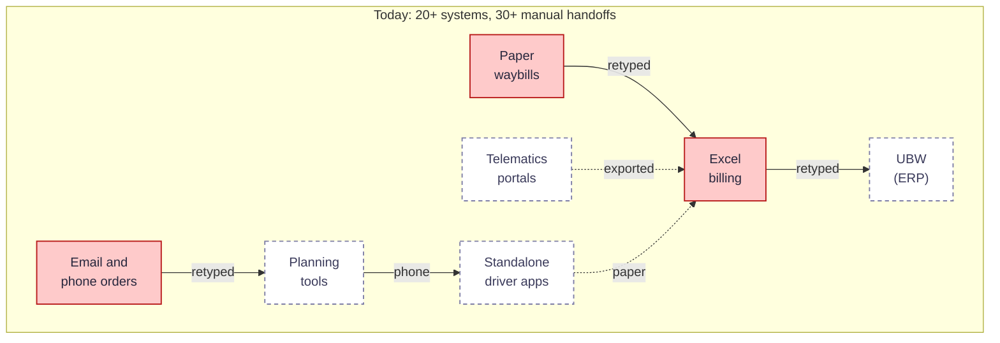
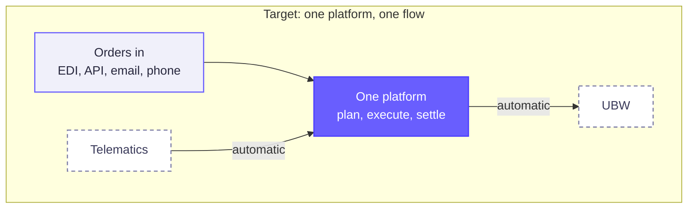

# Litra at a glance - who they are and what hurts

> **In short:** Litra is a 100-year-old Norwegian transport group. Its energy division moves fuel, gas and chemicals across the Nordics. The operation works, but it runs on 20+ disconnected systems, paper, email and Excel. They want one intelligent, automated flow from order to invoice.

## The company

| | |
|---|---|
| **Group** | Litra AS, founded **1917**, head office in Rudshøgda (near Lillehammer), Norway |
| **This engagement** | **Litra Energy Logistics AS**: gas, liquid fuel, bulk liquids and chemicals. "Nordic leader in fuel and chemical transport" |
| **Sister division** | Litra Green Logistics AS: temperature-controlled food, dry bulk, recycling, city distribution (a later phase at most) |
| **Countries** | Norway, Sweden, Finland, Denmark. About 45 depots, from Hammerfest to Malmö |
| **Size** | ~400-500 trucks, ~500 trailers, 800-900 employees, turnover above 175 M EUR. *Their slides disagree on the exact numbers: confirm* |
| **ERP** | UBW (Unit4) stays as the system of record for invoices and ledger |
| **Customers** | Energy and gas companies (for example St1, Gasum, Air BP, Preem, OKQ8), plus food, retail, industry and construction |

### The operating companies

| Company | Focus | Country |
|---|---|---|
| Litra Gass AS | Compressed and liquefied gas | Norway |
| Litra Gas AB | Bulk gas and energy | Sweden |
| Litra Finland OY | Gas and industrial energy | Finland |
| Litra Danmark A/S | Cross-border and energy | Denmark |
| Martinsen Transport AS/AB | Tank, bulk and liquids | Norway, Sweden |
| Litra Termo AS | Temperature-controlled food | Norway |

> Each company has its own currency, VAT rules, customers and possibly its own telematics. The platform must be **multi-company** from day one.

## The problem in their own words: "How hard can transport be?"

Customers see a straight line: **pickup, transport, deliver, 100% of the time, no misses.** Behind it sits a tangle.

**In plain words:** every arrow is a person copying data from one screen to another. Each copy is slow and can introduce errors.

**For the tech team:** the client slides list four root causes: manual order entry, legacy silos with no live APIs, isolated telematics and driver apps, and Excel billing with re-keying.

| Pain | What it causes |
|---|---|
| Many fragmented tools | Data islands across companies and departments |
| Poor integration | Few systems talk to each other |
| Manual handoffs | Spreadsheet consolidation, physical routines |
| Low data quality | Discrepancies, duplicates, late reporting, weak decisions |

## Where they want to go

Their vision has three parts:

1. **Automated decisions** - the system gives planners instant, optimal choices.
2. **Live 24/7 visibility** - real-time tracking and proactive updates on every leg.
3. **Instant, exact billing** - the invoice is created on delivery from actual km, hours, waiting time and type of operation, and sent to UBW.

## How they will judge the solution

| Pillar | What they ask for |
|---|---|
| **1. Functional core** | Tools for Planning, Execution and Back-Office, plus open APIs |
| **2. Intelligence and sustainability** | Machine learning and ESG support |
| **3. Platform interfaces** | Web or Windows for planning and back-office; Android or tablet web app for drivers |
| **4. Financial ROI** | Cost-competitive; the investment pays back through process savings |

> **Takeaway:** they are not asking for "another TMS". They are asking for fewer systems, no retyping and billing they can trust. Next: [the target flow](02-target-flow.md).
