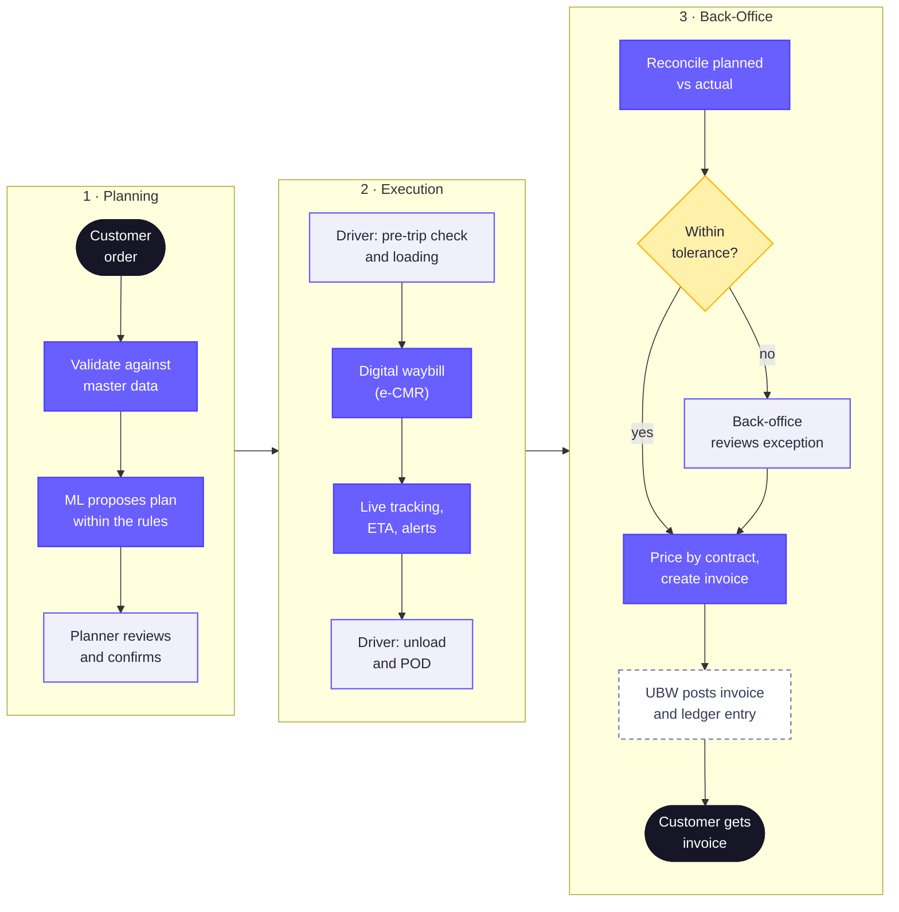
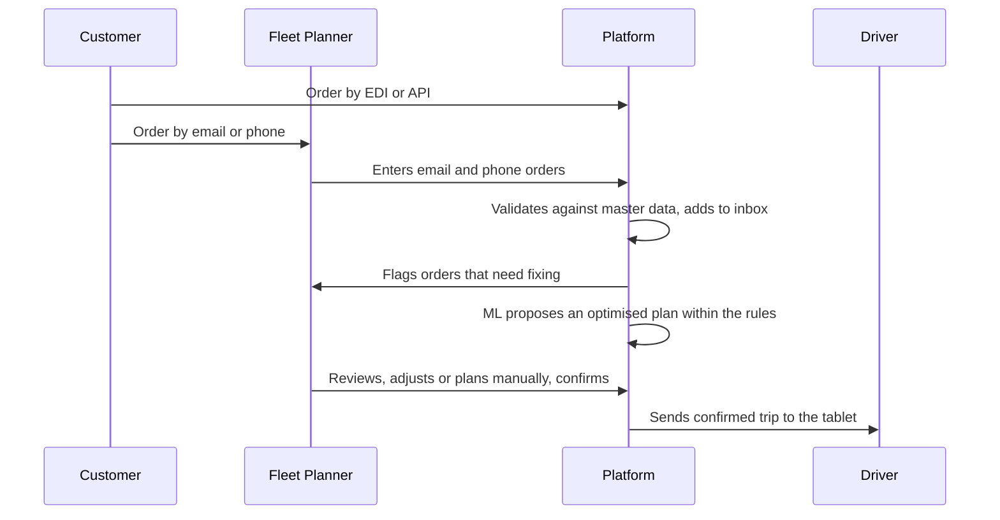
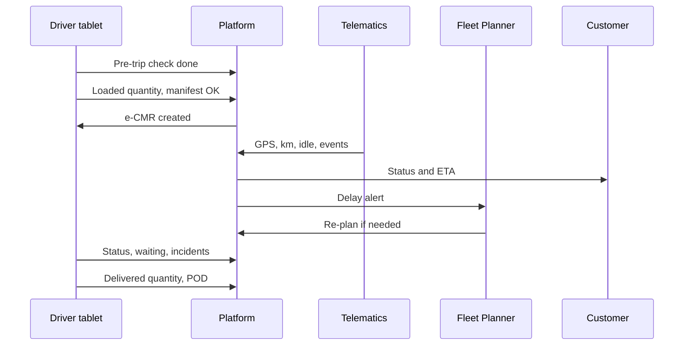
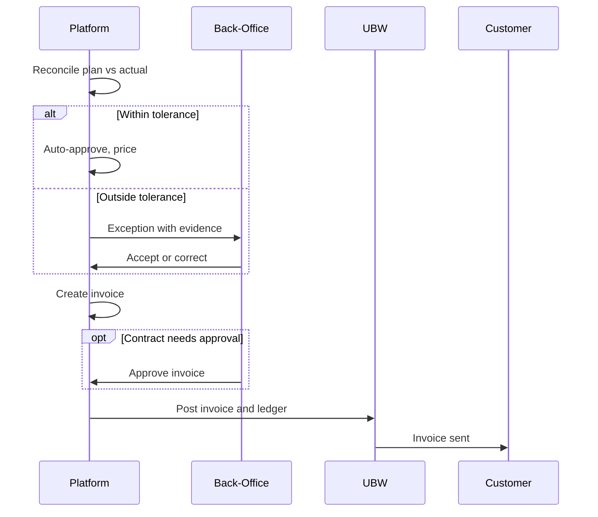

# Target flow - one order, zero re-keying

> **In short:** six actors, three phases, one decision gate. The order is captured once and every later step reuses that data. Machine learning proposes the plan, the planner confirms. Trips that match the plan are priced and invoiced with no human touch; only exceptions reach a person.

## The whole flow on one page

**In plain words:** purple boxes happen automatically. Light boxes are where a person acts. People are left only where their judgement adds value: confirming the plan, driving and delivering, and handling odd cases.

**For the tech team:** the purple steps are the automation scope. Each one consumes the output of the previous step without manual input, so data contracts between modules matter more than screens.

## Who does what, phase by phase

The diagrams below read like swimlanes: each column is an actor, time runs downward.

### Phase 1 - Planning

**In plain words:** most orders arrive by machine. The planner's job shifts from typing to checking.

**For the tech team:** validation runs at intake for every channel, so a broken site code is caught in the inbox, not at the customer's gate.

### Phase 2 - Execution

**In plain words:** the driver taps buttons instead of filling in paper. The truck reports itself. The customer knows the ETA without calling.

**For the tech team:** the tablet must work offline (tunnels, rural areas) and sync later. Telematics and tablet events are merged into one trip timeline.

### Phase 3 - Back-Office

**In plain words:** the back-office stops doing arithmetic and starts reviewing only what looks wrong.

**For the tech team:** tolerances and approval rules are per contract and editable by an administrator, not hard-coded.

## The decision gate: "Within tolerance?"

This single question decides whether a trip is billed automatically.

| Check | Default tolerance |
|---|---|
| Distance | ±5% vs plan |
| Trip time | ±10%, after removing confirmed waiting |
| Quantity | ±0.5% loaded vs delivered |
| Waiting time | ±10 minutes between driver and telematics |
| Proof of delivery | Present at every stop |

> **Why it matters:** the share of trips that pass this gate *is* the ROI. If 80% pass, the back-office looks at 20% of trips instead of 100%.
