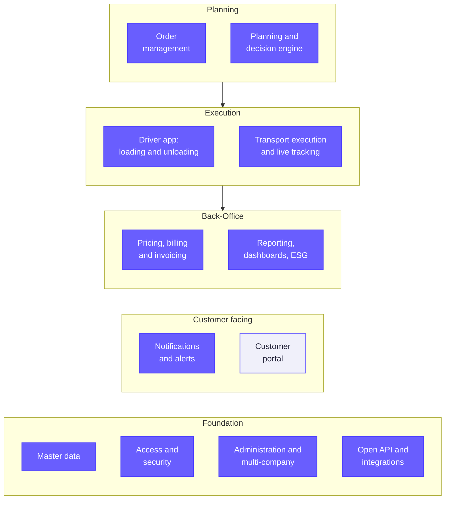

# Platform modules - what has to be built

> **In short:** twelve modules: eight that carry the flow from order to invoice and four foundation modules underneath (master data, access, admin, API). Eleven are needed for the first release (MVP). The customer portal and richer reporting come in Phase 2.

## The module map

**In plain words:** purple modules are in the first release. The light one, the customer portal, comes later. The foundation row carries everything above it.

**For the tech team:** each module matches one epic in the estimation workbook. The foundation modules are where integration and data-quality risk sits; they are not optional "admin screens".

## What each module does

### Order management
**Why Litra needs it:** orders arrive by paper, email and phone and are retyped.

| Feature | Phase |
|---|---|
| One inbox for all incoming orders, with "needs attention" flags | MVP |
| Create orders manually (phone) with live validation | MVP |
| Receive orders from customers' systems (EDI, API) | MVP |
| Order status and history from booking to invoice | MVP |
| Read orders from emails automatically | Phase 2 |
| Recurring orders | Phase 2 |
| Create orders from customer tank levels (VMI) | Future |

### Planning and decision engine
**Why:** planning lives in planners' heads and separate tools; Litra asked for "automated decision making".

| Feature | Phase |
|---|---|
| Availability of trucks, trailers and drivers (absence, maintenance) | MVP |
| Planning board: orders, resources, timeline and map in one view | MVP |
| Generate an optimised plan, with reasons for every choice | MVP |
| Review, edit or plan manually; overrides need a comment | MVP |
| Send trips to drivers' tablets | MVP |
| Re-plan trips already on the road | MVP |

### Driver app: loading and unloading
**Why:** paper waybills and manual quantity reporting.

| Feature | Phase |
|---|---|
| Loading instructions per compartment | MVP |
| Register loaded quantity (litres at 15 °C or kg), photo of loading document | MVP |
| Manifest check against order and documents | MVP |
| Digital waybill (e-CMR) with ADR details | MVP |
| Register delivered quantity per stop, extra work | MVP |
| Proof of delivery: signature or photo | MVP |

### Transport execution and live tracking
**Why:** isolated telematics and standalone driver apps; customers call to ask "where is my truck?"

| Feature | Phase |
|---|---|
| Driver's trips of the day, pre-trip safety check | MVP |
| Status updates, waiting time and incident reports | MVP |
| Telematics feed: GPS, km, idle, driving events | MVP |
| Live map of all active trucks, ETA | MVP |
| Delay and long-wait alerts | MVP |
| Planner-driver chat | Phase 2 |

### Pricing, billing and invoicing
**Why:** billing in Excel, re-keyed into UBW.

| Feature | Phase |
|---|---|
| Customer contracts and rate cards, surcharges | MVP |
| Reconcile planned vs actual with tolerances | MVP |
| Automatic trip pricing, each line with its source | MVP |
| Invoice creation per trip or per period | MVP |
| Approval and posting to UBW, error handling and retry | MVP |
| Credit notes | MVP |

### Notifications and alerts
In-app notifications, user preferences, customer status messages (SMS, email) and multilingual templates. **MVP.**

### Reporting, dashboards and ESG
Operations dashboard and CO₂ per trip in **MVP**. KPI dashboards and ESG reports per customer in **Phase 2**.

### Customer portal (Phase 2)
Customers book transports, track trucks, download waybills, PODs and invoices, and manage their own users.

### Foundation modules
- **Master data:** customers and sites, terminals, cargo types, trucks and trailers, drivers and their qualifications; file import. **MVP.**
- **Access and security:** company single sign-on, quick PIN login on the tablet, access by role *and* operating company. **MVP.** Customer login in Phase 2.
- **Administration and multi-company:** users, roles, operating companies (currency, VAT, language), settings and reference lists, audit log. **MVP.**
- **Open API and integrations:** documented public API, API client management, integration monitoring in **MVP**; event push (webhooks) in **Phase 2**.

> Project work also sits in the estimate: setup, documentation, Scrum ceremonies and stabilisation. It is not a module, but it is real effort.
