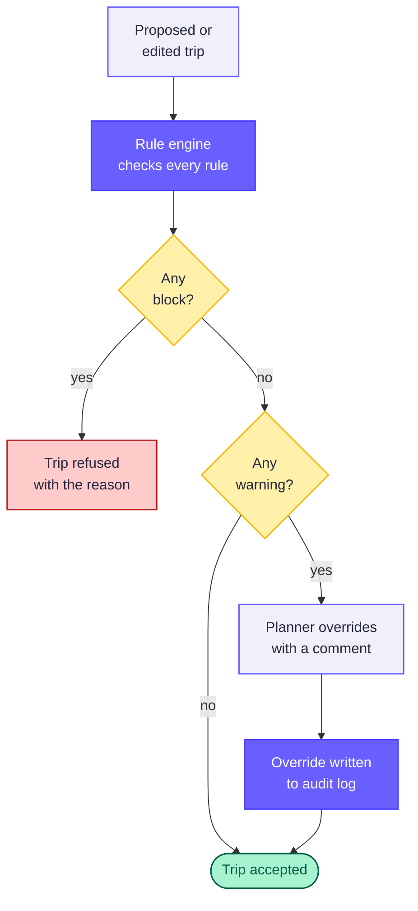
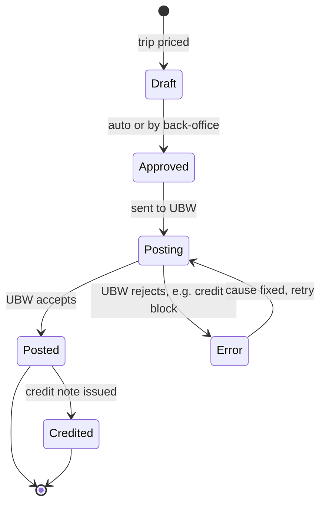

# Business rules - the logic the platform must enforce

> **In short:** the value of the platform is in its rules, not its screens. Four groups matter: which orders are valid, which trips are allowed, when a delivery can be billed automatically, and how a price is calculated. Every rule must be explainable to a planner or a customer.

## 1. Order validation (at intake)

An incoming order is checked the moment it arrives, whatever the channel.

| Check | Example of a failure |
|---|---|
| Customer exists and is active | Inactive customer sends an order |
| Delivery site is known and belongs to that customer | EDI order uses a site code nobody has mapped yet |
| Every product is known and has a quantity | Email order says "fill up the tank" with no quantity |
| Time window is given | No requested delivery time |
| Customer has a valid contract for that date | Contract expired last month |

A failed order is not lost. It lands in the inbox under **"needs attention"**, and for EDI orders the customer gets an automatic error reply.

## 2. Planning rules (before a trip is accepted)

Three levels of severity:

**In plain words:** some things are simply not allowed. Others are allowed if the planner takes responsibility and says why.

**For the tech team:** the same rule engine serves the ML optimiser, manual planning and re-planning. One source of truth, so the machine and the human are judged by the same rules.

| Severity | Rules |
|---|---|
| **Block** (never allowed) | Truck, trailer and driver missing · vehicle in maintenance · invalid truck and trailer combination · trailer ADR approval expired · driver ADR certificate expired on the trip date · no tank specialisation · certificate does not cover the cargo class · wrong licence category · driver absent · truck or driver double-booked · product not allowed in that tank type · compartment overfilled · two products in one compartment · jet fuel with any other product · incompatible products · daily driving above 10 hours |
| **Warning** (override with comment) | Arrival after the customer's time window · vehicle too long for the site · site needs a pump or meter the truck lacks · arrival outside site opening hours · driver from another operating company · extended driving day needed |
| **Info** (explanation only) | Driver's ADR certificate expires within 30 days · truck arrives more than an hour early · tunnel restriction applied to the route |

### Explainable proposals

Every trip the optimiser proposes comes with its reasons, for example: closest available unit, ADR valid, products fit the compartments, all time windows met, km saved vs a simple plan, a preference learned from past plans. It also lists **who was left out and why** (certificate expired, on vacation, in maintenance).

> **Why it matters:** planners will not trust a black box. Explanations turn ML from a threat into an assistant.

## 3. Reconciliation rules (after delivery)

| Check | Default tolerance | Sources compared |
|---|---|---|
| Distance | ±5% | Plan vs truck odometer |
| Trip time | ±10% after confirmed waiting | Plan vs status events and telematics |
| Quantity per order | ±0.5% | Terminal loading document vs meter or POD |
| Waiting time | ±10 min | Driver report vs geofence dwell |
| Proof of delivery | Required at every stop | Tablet |
| Extra operations | Must fit the site | e.g. pump use reported at a site that has its own pump is flagged |

All within tolerance: **auto-approved**. Any check outside: **exception** for review. Tolerances are settings, editable by an administrator.

**Waiting time is billed from facts.** If the driver reports 15 minutes and the geofence shows 52, the back-office sees both and decides which to bill, with a comment.

## 4. Pricing rules

- Each customer has **one active contract** pointing to a **rate card**.
- Rate card models: **volume by zone** (per m³), **weight by zone** (per tonne), **km + hour**. Zones are distance bands from the terminal.
- Extras: additional drops, waiting beyond a free allowance, pump use and other operations, surcharges.
- **Shared trips:** when one trip serves several customers on km + hour contracts, cost is split by each customer's share of delivered volume.
- Quantities used for billing are **standard litres at 15 °C** (liquids) or **kilograms** (gases).
- The contract also decides **auto-approval** and **invoice rhythm** (per trip or monthly).

## 5. Volume correction

Observed litres × correction factor = standard litres at 15 °C. The factor depends on product and temperature (industry tables; diesel shrinks or grows about 0.08% per °C). Gases are weighed, so no correction.

## 6. Invoice lifecycle

**In plain words:** an invoice is never silently lost or edited after posting. Errors are visible and can be retried; mistakes are corrected with a credit note.

**For the tech team:** posting is asynchronous with a retry queue. UBW's response is stored with the invoice, and every state change is audited.
