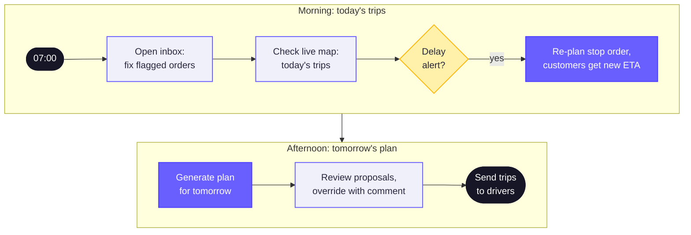
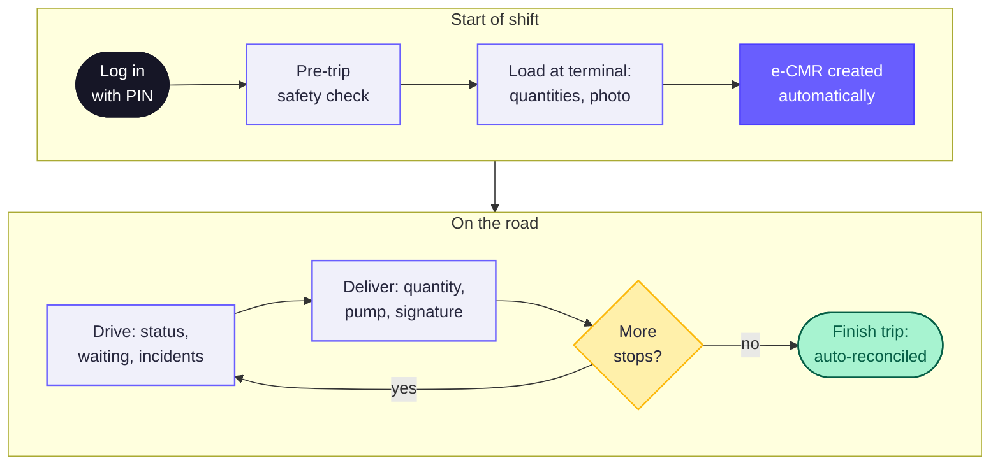
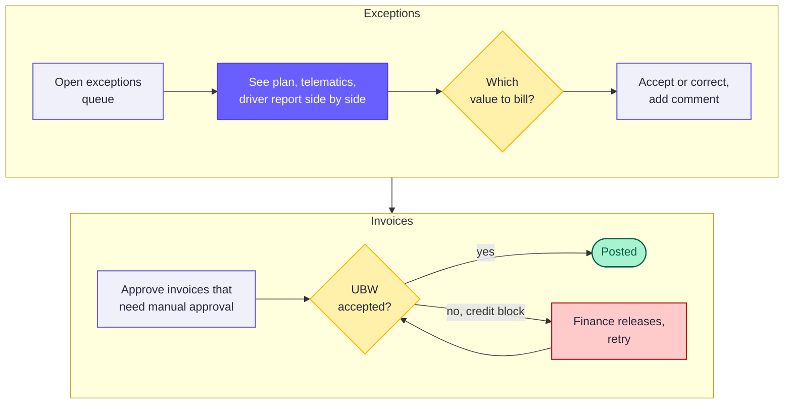

# Roles and journeys - who uses the platform and how

> **In short:** six user types. The Fleet Planner and the Driver use it all day; the Back-Office handles exceptions and invoices; the Manager watches the numbers; the Administrator configures; the Customer gets updates now and a portal later.

## The six roles

| Role | Device | Main job | Biggest change vs today |
|---|---|---|---|
| **Fleet Planner** | Web, big screen | Turn orders into trips, watch them run | From typing and phoning to checking and deciding |
| **Driver** | Tablet in the truck (Android) | Load, drive, deliver, report | From paper waybills to taps and signatures |
| **Back-Office Specialist** | Web | Review exceptions, approve invoices, manage contracts | From Excel arithmetic to exception handling |
| **Manager** | Web | Operations overview, KPIs, CO₂, ROI | From late reports to live numbers |
| **Administrator** | Web | Users, roles, companies, tolerances, integrations | New role, owns the configuration |
| **Customer** | Email, SMS, API; portal in Phase 2 | Send orders, follow deliveries, get invoices | From calling to being told |

> **Assumption to confirm:** one Fleet Planner role covers both planning and dispatch. Some hauliers split these into two jobs.

## A day in the life: Fleet Planner

**In plain words:** the planner spends the morning on today's surprises and the afternoon on tomorrow's plan, which the machine drafts.

**For the tech team:** the planning board is the most demanding screen: many orders, resources, a timeline and a map, updated live.

## A day in the life: Driver

**In plain words:** big buttons, few steps, works with gloves on. The driver never types an address or a price.

**For the tech team:** offline-first. Every action is stored on the tablet and synced when there is signal. Language per driver (Norwegian, Swedish, English at least).

## A day in the life: Back-Office

**In plain words:** the back-office only touches trips that look wrong, and has all the evidence on one screen.

**For the tech team:** evidence means stored raw data per trip (telematics dwell, odometer, tablet events, photos), not just the final numbers.

## Manager and Administrator, briefly

- **Manager:** a control tower showing the pipeline from inbox to UBW, on-time rate, auto-reconciled share, delivery-to-invoice time, CO₂ per customer and an ROI view.
- **Administrator:** sets up companies (currency, VAT, language), roles and permissions, tolerances, notification templates, API clients; watches the integration log and the audit log.

## Access: role *and* company

A user sees only the data of their own operating company, and only the actions their role allows. A planner at Litra Gass Norway does not see Martinsen's customers. A group-level manager can see all companies.
