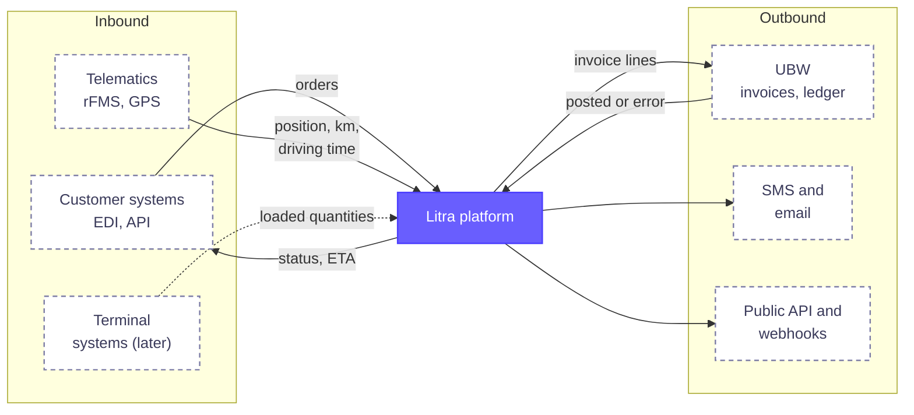
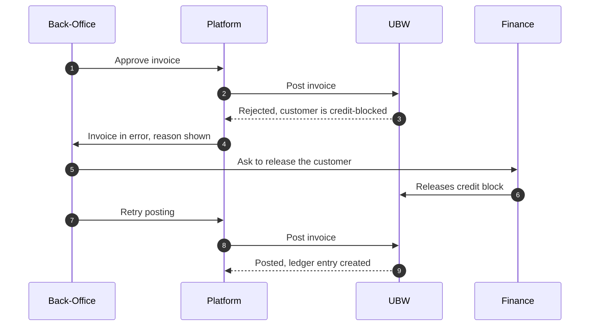

# Integrations - how the platform connects to Litra's world

> **In short:** the platform replaces planning tools, standalone driver apps and Excel billing. It **connects to** what stays: UBW for finance, telematics for vehicle data, customers' systems for orders, and SMS and email for notifications. It must not become the 21st silo.

## Replace or integrate?

| Replace (the platform does it) | Integrate (keeps running, platform connects) |
|---|---|
| Planning tools | **UBW** (Unit4 ERP): invoices, ledger, customer credit |
| Standalone driver apps | **Telematics**: truck makers' rFMS or third-party boxes |
| Excel billing and price calculation | **Customers' systems**: EDI and API orders, status messages |
| Paper waybills | **Terminals**: loading data (later; photo of loading document first) |
| | **SMS and email** gateways |

> This split is Geniusee's suggestion. Confirming it is one of the main questions for 1 Dec.

## The context picture

**In plain words:** data comes in from customers and trucks, goes out to finance and customers. The platform is the hub in the middle.

**For the tech team:** each external system gets its own adapter behind one integration layer, so a second telematics provider or a new EDI customer is configuration plus an adapter, not a rewrite.

## Each integration in one table

| System | Direction | What flows | How often | When it fails |
|---|---|---|---|---|
| **UBW** | Out, with reply | Invoices, credit notes, ledger lines; reply posted or rejected | Per invoice, near real time | Show the error on the invoice; retry after the cause is fixed |
| **Telematics** | In | Position, odometer, driving time, idle, events | Every few minutes per truck | Fall back to tablet GPS; mark data as "from tablet" |
| **Customer EDI** | In and out | Orders in (IFTMIN), acknowledgement or error (APERAK), status out (IFTSTA) | Per order and status change | Invalid order goes to "needs attention", error reply sent |
| **Customer API** | In and out | Same as EDI, as JSON | Real time | Clear error codes; customer can resend |
| **SMS and email** | Out | ETA, delay notices, delivery confirmation | Per event | Retry; log delivery status |
| **Terminals** (later) | In | Loaded quantities per compartment | Per loading | Driver enters from the loading document |

## Example: invoice rejected by UBW

**In plain words:** when finance says no, the invoice does not vanish into an email thread. Everyone sees why, and one click resends it once the issue is solved.

**For the tech team:** posting is idempotent (a retry never creates a duplicate invoice), and the full request and response are kept in a message log with a resend button.

## Open questions that shape the integration work

1. Which **telematics providers** per company, and is there API access in real time?
2. Which **customers need EDI or API** from day one, and in which formats?
3. Should **UBW** keep issuing and sending invoices (for example as EHF), or should the platform send them?
4. Who records **loading quantities**: the driver, Litra staff, or the terminal's own system?
5. Is any **data migration** needed beyond master data and open orders?
