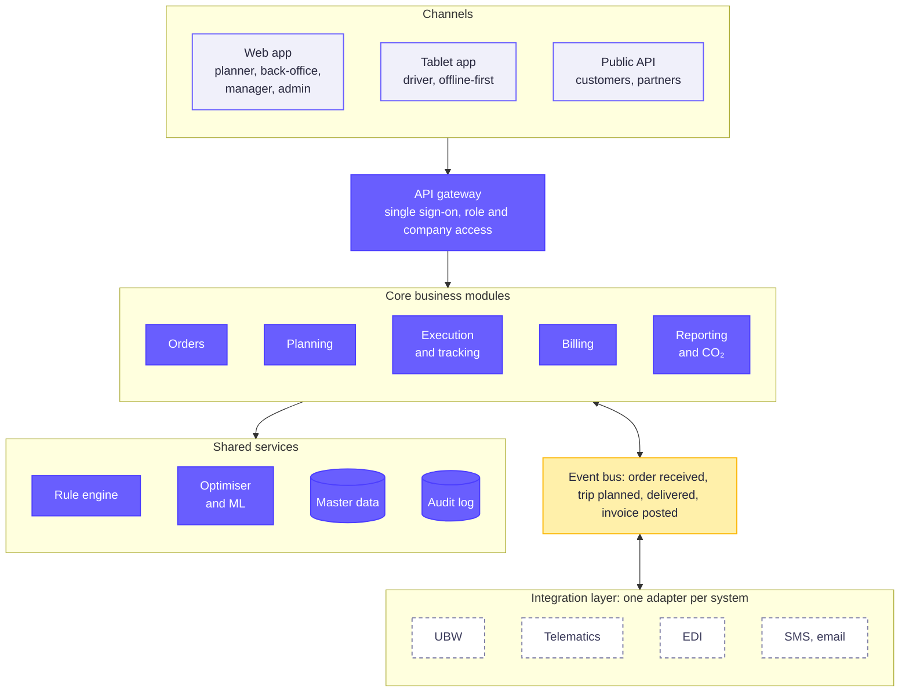
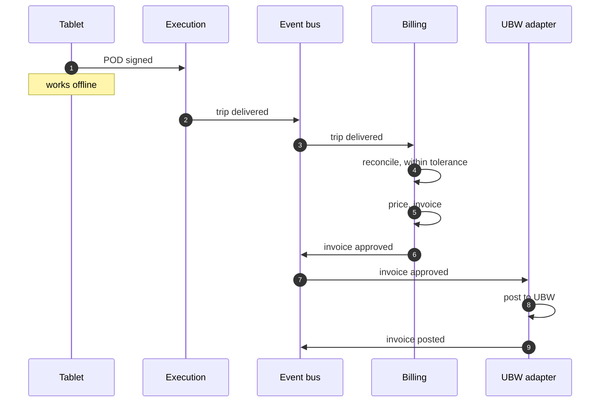

# Logical architecture - how the platform is put together

> **In short:** three front doors (planner web app, driver tablet app, public API), a core of business modules around one shared rule engine, a separate planning and ML service, and an integration layer that talks to UBW, telematics and customers through events. Technology-neutral: this shows *what* the parts are, not which vendor builds them.

## The big picture

**In plain words:** many doors in, one brain in the middle, and a single switchboard to the outside world. Adding a new customer system or truck brand touches only the switchboard.

**For the tech team:** modules communicate through events, not direct calls to each other's databases. The rule engine is a shared library or service used by planning, re-planning and validation alike.

## The building blocks

| Block | Responsibility | Design notes |
|---|---|---|
| **Web app** | Planning board, inbox, billing, admin | Data-dense screens, live updates (push, not refresh) |
| **Tablet app** | Driver workflow | Offline-first, local queue, sync on signal; Android or tablet web |
| **Public API** | Orders in, status out, documents | Versioned, documented, per-client keys and limits |
| **API gateway** | Login and access | Company SSO for staff, PIN for drivers; access by role **and** operating company |
| **Core modules** | Orders, planning, execution, billing, reporting | Each owns its data; one state machine per order, trip and invoice |
| **Rule engine** | ADR, legal, site, capacity, tolerance rules | Deterministic, testable, returns block, warning or info with a reason |
| **Optimiser and ML** | Plan proposals, ranking, learned preferences | Propose-only in MVP; never relaxes a hard rule; explains every choice |
| **Master data** | Customers, sites, terminals, products, fleet, drivers | Single source; import from existing systems |
| **Event bus** | Moves business events between modules and adapters | Reliable delivery, replay after failure |
| **Integration layer** | Adapters for UBW, telematics, EDI, messaging | Message log, retries, idempotency, resend |
| **Audit log** | Who changed what and when | Covers orders, plans, overrides, prices, invoices |

## Example: from signature to ledger in one event chain

**In plain words:** the driver's signature sets off a chain reaction. A few seconds later the invoice is in UBW, unless something looks wrong.

**For the tech team:** each step is idempotent and can be replayed. If UBW is down, the event waits in the queue; nothing is lost and nobody retypes anything.

## Cross-cutting concerns

- **Multi-company:** every record belongs to an operating company. Currency (NOK, SEK, DKK, EUR), VAT, language and templates follow the company.
- **Offline:** the tablet keeps working without signal; conflicts are resolved by "last action from the field wins" for driver data.
- **Security and privacy:** driver location is personal data under GDPR; access is limited and retention defined.
- **Observability:** an integrations dashboard shows message flow, failures and retries.
- **Scale:** sized by trucks, drivers, planners and orders per day. Volumes are still to be confirmed, so performance targets are open.

> **What this page does not decide:** cloud provider, programming languages, mobile framework, database products. Those choices follow once scope and volumes are confirmed.
