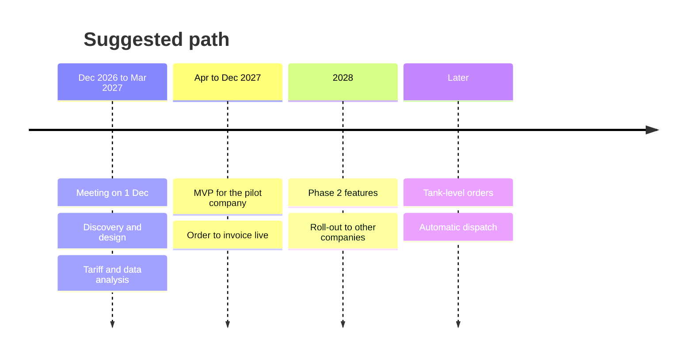
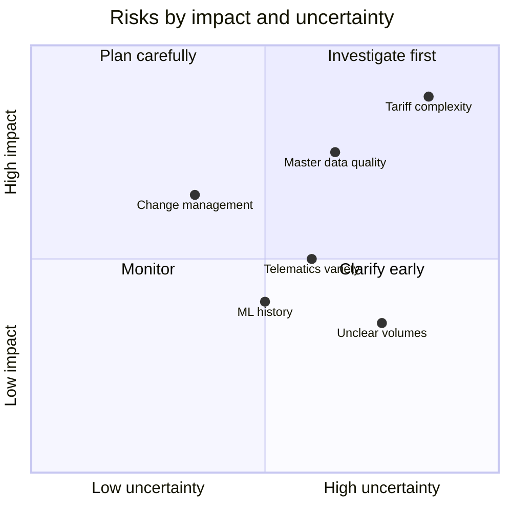

# Scope and roadmap - what comes first and what can go wrong

> **In short:** start with the full order-to-invoice flow for **one operating company** (suggested: Litra Gass Norway). Then add the customer portal, smarter intake and reporting, and roll out to the other companies. Tank-level ordering and automatic dispatch come last. The build window under discussion is **April to December 2027**.

## Three phases

| Phase | Goal | What is in it |
|---|---|---|
| **MVP** | Prove "one order, zero re-keying" end to end in one company | Order inbox, EDI and API for key customers, master data, ML plan proposals with the rule engine, driver tablet, live tracking and customer updates, reconciliation, pricing, UBW posting and credit notes, CO₂ per trip, operations dashboard, open API, admin and audit |
| **Phase 2** | Reduce the remaining manual work, roll out | Customer portal, email order reading, recurring orders, planner-driver chat, KPI dashboards and ESG reports, webhooks; onboarding of more operating companies |
| **Future** | From reacting to anticipating | Orders from customer tank levels (VMI), automatic dispatch for routine deliveries, roll-out to Green Logistics |

## Roadmap at a glance

**In plain words:** one company first, fully working, then the rest. A smaller first step with real billing beats a big first step that only plans.

**For the tech team:** dates after December 2027 are illustrative. The MVP window is the client's, still to be confirmed.

## Why one pilot company

- One set of customers, contracts and tariffs to analyse.
- One telematics setup to integrate first.
- A real, measurable before-and-after: delivery-to-invoice time, auto-reconciled share.
- **Litra Gass Norway** is suggested because gas is the most demanding case (weight-based billing, strict ADR, tunnel limits). If it works for gas, it works for diesel.

## Top risks and how to handle them

| Risk | Why it is a risk | How to handle it |
|---|---|---|
| **Tariff complexity** | Number and shape of customer tariffs is unknown; may be hundreds of Excel exceptions | Analyse tariffs early; standard rate-card model plus customer overrides; import from Excel |
| **Master data quality** | 20+ systems mean duplicates and conflicts in sites, customers, vehicles | Clean-up as a discovery task; import with row-level validation |
| **Telematics variety** | Different providers per company, uneven API access | One integration layer; tablet GPS as fallback |
| **ML needs history** | Good proposals need 12+ months of trips and orders | Start with rules and optimisation; ML learns as data accumulates; propose-only in MVP |
| **Change management** | Planners and drivers have their own routines | Explainable proposals, planner keeps control, drivers get a simpler app than paper |
| **Unclear volumes** | Fleet and headcount figures conflict across the client's slides | Confirm planners, drivers, trucks and orders per day; size performance and licences on that |

**In plain words:** top-right is where to spend discovery time. Tariffs are the single biggest unknown for both cost and timeline.

**For the tech team:** these positions are judgement, not measurement. They show where estimates need the widest ranges.
