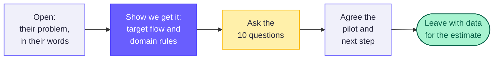

# Meeting playbook - 1 December 2026

> **In short:** the goal is not to sell. It is to show that Geniusee understands tank haulage well enough to be trusted with it, and to leave with the answers that make a real estimate possible. Listen more than you talk.

## What a good meeting looks like

**Success means:** a confirmed pilot company, a replace-vs-integrate list, a feel for tariff complexity, and a date for a deeper session.

## Three messages to land

1. **One order, zero re-keying.** "Your data is entered once, by the customer's system or by one planner, and reused all the way to UBW."
2. **The machine proposes, the planner decides.** "ML works inside hard ADR and legal rules, explains every choice, and your planners stay in control."
3. **Billing from facts.** "Each invoice line traces back to telematics, the POD or the contract. Your back-office only sees the trips that look wrong."

## Show you know the trade

Drop these naturally; they signal real domain understanding.

- "Billing in **standard litres at 15 °C** for liquids, **kilograms** for gas, so loaded and delivered quantities compare like with like."
- "**Jet fuel needs a dedicated trailer**, and AdBlue has to stay away from fuel, so compartment allocation is part of planning."
- "The plan checks the **ADR certificate for the trip date**, not today, plus the tank course and remaining **tachograph** time."
- "**Waiting time** is billed when the geofence confirms it, not just the driver's note."
- "We see UBW as the **system of record**. We feed it, we don't replace it."

## The 10 questions, and why we ask

| # | Ask | Why it matters |
|---|---|---|
| 1 | Which **operating company and country** should go first? Is Green Logistics in scope? | Defines the pilot and the MVP size |
| 2 | Which of the **20+ systems** stay, which go? Any **data migration** beyond master data and open orders? | Integration scope and migration effort |
| 3 | Should ML **propose only**, or dispatch automatically in some cases? How much **history** exists? | ML approach; 12+ months of trips is ideal |
| 4 | Which **telematics providers** per company? API access, real time? | Number and type of integrations |
| 5 | How do orders arrive today? Which **customers need EDI or API** from day one? | Intake channels for MVP |
| 6 | How many **contract and tariff types**? How are they built and where are they kept? | **The biggest estimation risk** |
| 7 | Who **approves invoices**? Does **UBW keep sending** them? Per trip or **per period**? | Billing flow and UBW integration depth |
| 8 | How many **planners, drivers, trucks**, orders and trips **per day**? Planning and dispatch: one role or two? | Performance, licensing, UX for the planning board |
| 9 | Who records **loading quantities**: driver, Litra staff, or the terminal's system? | Tablet flow vs terminal integration |
| 10 | What must be live first? Is **April-December 2027** fixed? Budget range? | Scope cut and phasing |

> **Tip:** ask for examples, not descriptions. "Can you send us three real tariff sheets and one month of anonymised trips?" is worth more than an hour of talk.

## Signals to listen for

| If you hear | It probably means |
|---|---|
| "Every customer has its own deal" | Many tariff variants; widen the pricing estimate |
| "Each company bought its own system" | Several telematics and data sources; heavier integration layer |
| "Planners don't trust suggestions" | Explanations and manual control are must-haves, not nice-to-haves |
| "Finance owns UBW, we can't touch it" | Integration through a defined interface only; involve finance early |
| "Drivers hate new apps" | Driver UX and offline mode deserve extra attention |
| "We tried a TMS before" | Ask what failed. It tells you what not to repeat |

## Likely objections, short answers

| Objection | Answer |
|---|---|
| "We already have planning software." | "Fine, keep what works. The question is whether it talks to billing and UBW without retyping. That is where the 30 handoffs are." |
| "ML is a black box." | "Every proposal shows its reasons and which resources were excluded. Hard rules can never be relaxed; overrides are logged." |
| "Our tariffs are too complex to automate." | "Most tariffs follow a few patterns plus exceptions. Send us real examples and we will show how many fit a standard model." |
| "Our drivers will not use a tablet." | "The tablet replaces paper, not adds to it: fewer steps, works offline, in their language." |
| "This sounds expensive." | "Start with one company and measure delivery-to-invoice time and manual corrections. The savings case is built from your numbers." |

## Things not to say

- **Don't** say we will replace UBW. It stays.
- **Don't** promise automatic dispatch in the MVP. Propose-only first.
- **Don't** quote a single fleet or headcount number. Their slides disagree; ask instead.
- **Don't** give a price or a firm timeline. Tariffs and volumes are still unknown.
- **Don't** pitch features. Tie every point back to a pain on their own slides.
- **Don't** pretend to know their regulations better than they do. Ask how they handle ADR and tunnels today.

## After the meeting

- Write down the answers to the 10 questions while fresh.
- Request the follow-up material: tariff samples, trip history extract, system list, telematics provider list, volumes per company.
- Update the estimate assumptions with what you learned.
