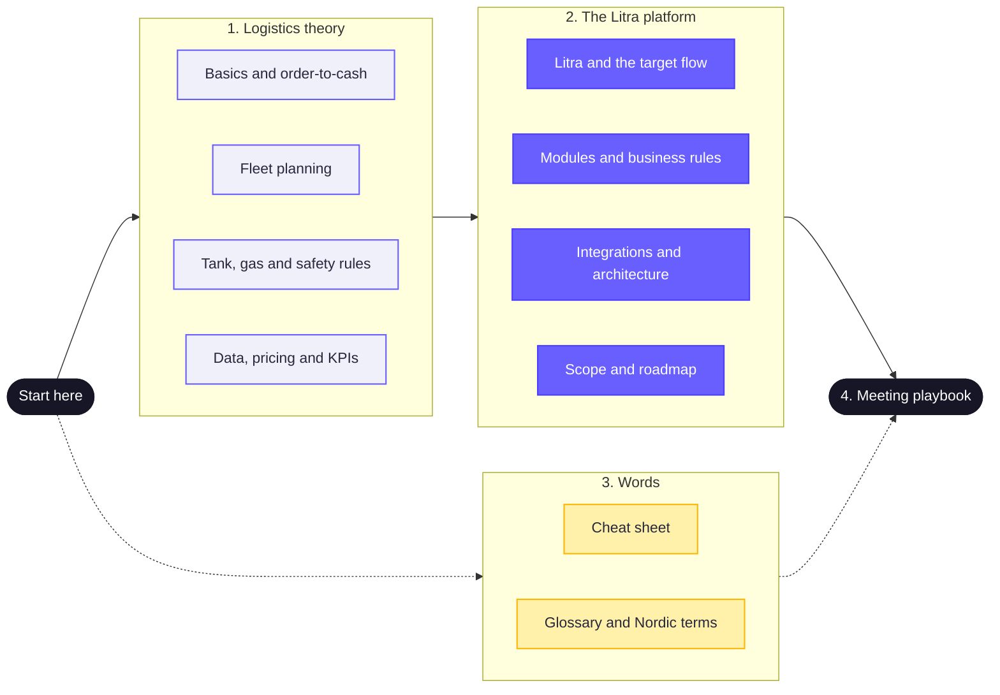
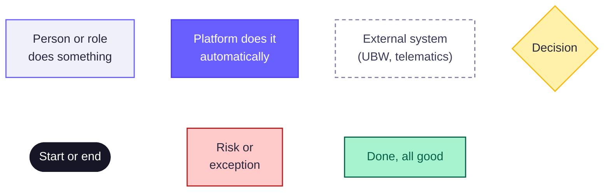

# Litra Knowledge Base - logistics, the platform and the words

> **In short:** everything you need to talk confidently with Litra Energy Logistics on 1 December 2026. How road tank haulage works, what the platform must do for Litra, and the vocabulary that goes with it.

## The idea in one line

**One order, zero re-keying.** One platform carries every transport order from the moment the customer sends it to the moment the invoice is posted in Litra's ERP (UBW). Nobody types the same data twice.

## Who Litra Energy Logistics is (30 seconds)

- Part of **Litra AS**, a Norwegian transport group founded in **1917**.
- Hauls **fuel, gas, bulk liquids and chemicals** by road in Norway, Sweden, Finland and Denmark.
- Runs roughly **400-500 trucks** and **~500 trailers** with **800-900 people** (their own slides disagree, so confirm).
- Today they juggle **20+ separate systems** and **30+ manual handoffs**. Billing is done in Excel.

## Pick your reading path

| You have | Read this | Time |
|---|---|---|
| 15 minutes | [Cheat sheet](03-glossary/01-cheat-sheet.md), then [Litra at a glance](02-litra-platform/01-litra-at-a-glance.md) | 15 min |
| An evening before the meeting | Add [Target flow](02-litra-platform/02-target-flow.md), [Tank and gas transport](01-theory/04-tank-and-gas-transport.md) and the [Meeting playbook](04-meeting-playbook/01-meeting-playbook.md) | 1 hour |
| A real deep dive | Everything, in order. Theory first, then the platform | 3 hours |

## How the knowledge base is organised

**In plain words:** learn the trade first, then see how the platform answers Litra's problems, and keep the word lists open on the side. Finish with the playbook.

**For the tech team:** section 2 is the functional view of the solution. Modules map one to one to the epics in the estimation workbook.

## How to read the diagrams

Every flow diagram in this knowledge base uses the same colours.

Each diagram is followed by two short notes:

- **In plain words** - what it means for the business.
- **For the tech team** - what it means for the build.

> Facts about Litra come from the client's own slides and Geniusee's pre-sales analysis. Where the client's numbers conflict, this knowledge base shows a range and says "confirm".
